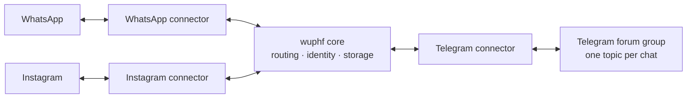

# wuphf wiki

wuphf bridges your chats between platforms. A typical setup mirrors every
WhatsApp and Instagram chat into its own topic of a Telegram forum group, so
you can read and answer all of them from Telegram. Replies, edits, deletes,
reactions, media, stickers, pins and mutes cross both ways.

It is built as **one logical message with many copies**: the Rust core knows
which platform messages are the same message. That is what makes replies,
edits and deletes land on the right copy, and what stops a bridged message
from echoing back forever.

Connectors are thin pipes, one per account. The core decides everything.

## Pages

| Page | What it covers |
|------|----------------|
| [Getting started](Getting-Started.md) | From a fresh checkout to a running bridge, step by step. |
| [Concepts](Concepts.md) | Messages and copies, conversations, rules, the owner, notices. |
| [Components](Components.md) | Every binary: what it does, what it supports, what it needs. |
| [Configuration](Configuration.md) | The full guide: every config file, tokens, rules, runtime settings. |
| [Operations](Operations.md) | Installing on a server, updates, backups, logs and owner notices. |
| [Troubleshooting](Troubleshooting.md) | Symptoms and their fixes. |
| [Development](Development.md) | The code layout, tests, and adding a connector or a feature. |

## Longer documents

- [Architecture](../architecture.md): the identity, routing and storage model.
- [Connector protocol](../connector-protocol.md): the gRPC contract every
  connector speaks.
- [systemd deployment](../../deploy/systemd/README.md): units, layout, first
  logins.
- [Releases](../../release/README.md): making a release and the signing key.
- Per part: [Telegram](../../connectors/telegram/README.md),
  [WhatsApp](../../connectors/whatsapp/README.md),
  [Instagram](../../connectors/instagram/README.md),
  [mediaconv](../../providers/mediaconv/README.md),
  [wuphf-misc](../../misc/README.md).
- The [README](../../README.md), and the [plans](../../plans/README.md) behind
  each feature.
